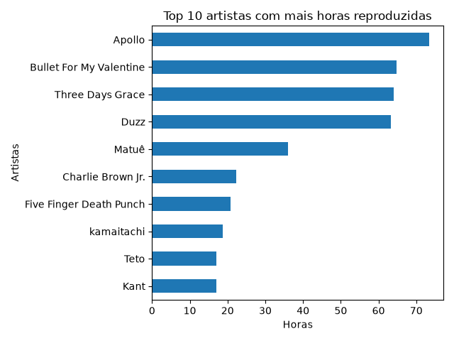
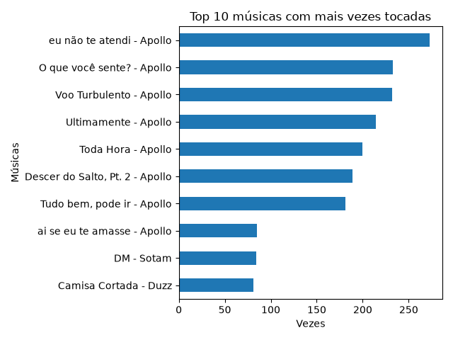
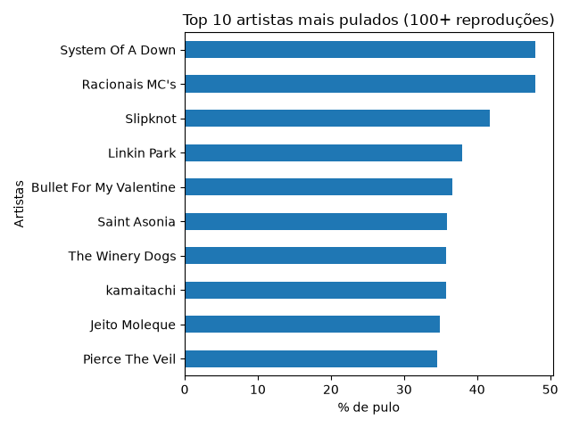
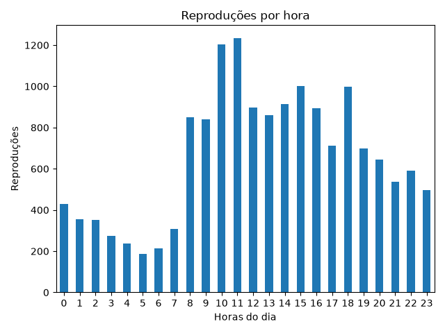
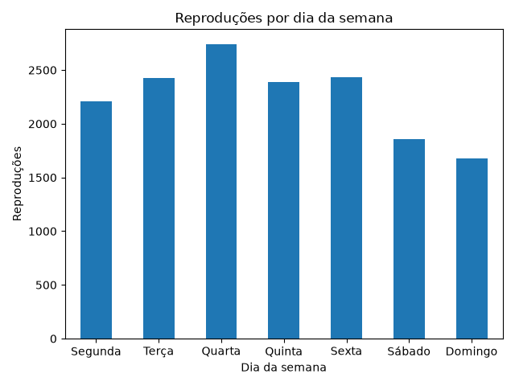

# Análise do meu histórico do Spotify

Projeto de ciência de dados feito do zero em Python (pandas e matplotlib) para analisar a minha própria escuta no Spotify entre **05/11/2025 e 05/11/2026**.

## O que o projeto responde

- Quantas horas eu escutei, e quais artistas e músicas mais ouvi?
- Em que horas e em que dias da semana eu mais escuto?
- Quais artistas eu mais pulo?

## Principais resultados

- **20.938** reproduções no ano. Contei como "ouvida" a que passou de **30 segundos**: **15.735** ouvidas e **5.203** puladas (taxa de pulo geral de **24,8%**).
- Separei **555** reproduções de ruídos de dormir (ruído marrom, sons de ambiente), que ficam sobretudo entre 0h e 7h. Sobraram **15.180** reproduções de música, num total de **790 h 41 min**, de **493** artistas e **1.874** músicas diferentes.
- O artista mais ouvido em horas é o **Apollo** (73,5 h), seguido de Bullet For My Valentine, Three Days Grace e Duzz.
- Os horários de pico são **10h–11h**, **15h** e **18h**. A quarta-feira é o dia mais ouvido e o domingo o menos ouvido.
- Entre os artistas com 100+ reproduções, **System Of A Down** e **Racionais MC's** são os mais pulados (48%). O Apollo é o menos pulado (8%).

## Gráficos







## Decisões e limitações

- **30 segundos:** uma reprodução só conta como ouvida com 30 s ou mais (`>=`), o mesmo critério usado pelo Spotify.
- **Ruídos de dormir:** foram identificados por uma lista de 18 artistas, escolhidos por terem 6 ou mais reproduções suspeitas. Artistas com menos que isso não foram verificados, então pode sobrar um pouco de ruído nos dados (por volta de 1%).
- **Taxa de pulo por artista:** só entram artistas com pelo menos 100 reproduções, sem ruídos e sem o "Unknown Artist" (faixas sem informação).
- **Gráficos de hora e dia da semana:** incluem os ruídos de dormir, por isso a madrugada aparece mais cheia.
- Foi usado só o arquivo "Account Data" (12 meses). O histórico estendido do Spotify não foi usado.
- **Lista de ruídos:** a lista `ARTISTAS_RUIDO` foi montada para a minha escuta. Com outros dados, ela precisa ser ajustada.

## Tecnologias

Python 3.14 · pandas · matplotlib · Git/GitHub

## O que eu pratiquei neste projeto

- Ler e juntar arquivos JSON com pandas (`read_json`, `concat`)
- Limpar e filtrar dados (`>=`, `isin`, `~`, `str.contains`)
- Trabalhar com datas e fuso horário
- Agrupar e resumir (`groupby`, `value_counts`, `sort_values`)
- Criar gráficos com matplotlib e salvar em arquivo
- Organizar um projeto com Git, `.gitignore` e `requirements.txt`

## Próximos passos

- Analisar o histórico estendido do Spotify (desde 2020, ~158 mil linhas)
- Comparar a escuta ao longo dos anos

## Como rodar

1. Instale as bibliotecas:
   ```
   pip install -r requirements.txt
   ```
2. Peça os seus dados em spotify.com (Privacidade → Baixar seus dados) e coloque os arquivos `StreamingHistory_music_0.json`, `_1.json` e `_2.json` em `dados/Spotify Account Data/`. Essa pasta não vai para o GitHub, por conter dados pessoais.
3. Rode `analise_spotify.py`. Os gráficos são salvos na pasta `graficos/`.